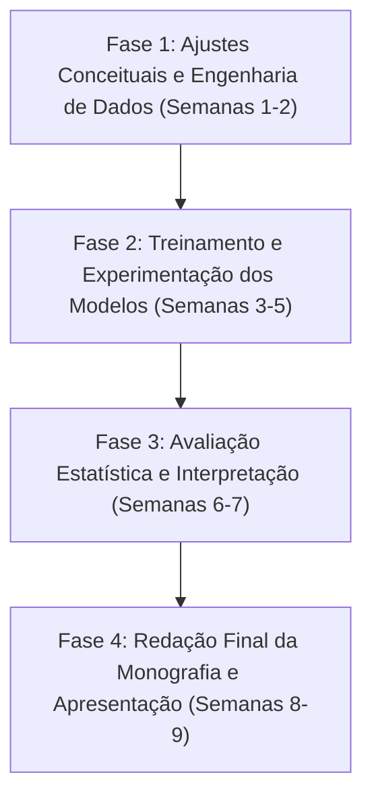

# Plano de Desenvolvimento e Cronograma de Conclusão do TCC

**Título do Trabalho:** Avaliação da Resiliência de Redes Neurais de Grafos a Concept Drift na Detecção de Botnets em IoT  
**Autora:** Letícia Alves de Pontes  
**Orientador:** Prof. Me. Paulo Rogério de Mello Cardoso  
**Data de Atualização:** Outubro de 2026  

---

## 1. Contexto e Decisões de Escopo

Com base no parecer e nas observações da banca de qualificação (Prof. Dr. Moacyr Correa), foram tomadas decisões cruciais para blindar metodologicamente o trabalho e garantir viabilidade de entrega:

1. **Separação Conceitual entre Drift Temporal e Domain Shift:**
   - **Cenário T (Temporal Drift - Gradual):** Conduzido internamente no dataset **IoT-23**, preservando a ordem cronológica estrita das capturas (treino nas mais antigas, teste nas mais recentes).
   - **Cenário D (Domain Shift / Heterogeneidade entre Bases):** Avaliação de transferência cruzada entre bases distintas (ex.: treino em **IoT-23** e teste em **Bot-IoT**), reconhecendo explicitamente as diferenças de infraestrutura, topologia e equipamentos, separando o efeito da harmonização de atributos da degradação de desempenho.
2. **Isonomia e Comparação Justa (Fairness Protocol):**
   - Garantir que todos os modelos recebam o mesmo protocolo de adaptação. Se o **PPT-GNN** receber ajuste supervisionado com poucos exemplos (*few-shot*) no subconjunto reservado de validação, os modelos *baseline* (*Random Forest*, *E-GraphSAGE* e *EvolveGCN-H*) passarão pelo mesmo processo de ajuste equivalente sobre as mesmas amostras.
3. **Corte Estratégico de Escopo (Docker & Zeek):**
   - O ambiente experimental virtualizado em containers com simulação de tráfego em tempo real, Zeek e injeção de botnets ativas foi **despriorizado e removido do escopo principal**, sendo reservado para a seção de *Trabalhos Futuros*. O foco total do TCC concentra-se na validação quantitativa e estatística rigorosa dos datasets públicos.

---

## 2. Checklist de Entregas

### 2.1 Concluído

- [x] **Monografia de Qualificação:** Fundamentação teórica, delimitação da questão de pesquisa e aprovação em banca.
- [x] **Configuração da Infraestrutura de Código:**
  - Repositório estruturado com empacotamento moderno via `pyproject.toml`.
  - Configurações centralizadas (`src/config.py`).
  - Módulos iniciais de dados e grafos (`src/data.py`, `src/graphs.py`, `src/shift.py`).
  - Testes unitários iniciais (`tests/test_data.py`).
  - Notebooks de automação de ambiente e exploração de dados (`notebooks/00_setup.ipynb`, `notebooks/01_iot23_exploracao.ipynb`).

---

### 2.2 Pendente (A Fazer)

#### Bloco A: Ajustes Metodológicos e Redação do Texto

- [x] Atualizar o texto da **Metodologia (Seção 3 e 4)** formalizando a distinção entre *drift temporal* (IoT-23) e *domain shift* (IoT-23 $\rightarrow$ Bot-IoT, com ToN-IoT como expansão opcional e remoção do CTU-13) (ver `METODOLOGIA_REVISADA.md`).
- [x] Documentar formalmente o protocolo de isonomia de adaptação *few-shot* para todos os modelos baselines.
- [x] Descrever o impacto e isolamento da etapa de harmonização de esquemas (*feature mapping*).
- [x] Remover a dependência do pipeline de simulação Docker/Zeek do texto principal.

#### Bloco B: Pipeline de Dados & Representação em Grafos

- [x] Harmonizar variáveis e gerar parquets finais dos cenários (IoT-23, TON-IoT e CTU-13 via `src/harmonization.py`).
- [x] Implementar a segmentação em snapshots temporais para modelos dinâmicos (`create_temporal_snapshots` em `src/graphs.py`).
- [x] Implementar e testar o cálculo da heurística de pesos das arestas (`compute_edge_weights` em `src/graphs.py`):
  $$w(u, v) = \frac{f(u,v)}{\sum_i f(u,i)}$$
- [x] Pipeline de particionamento cronológico (80/20) e *undersampling* aleatório estratificado aplicado exclusivamente ao conjunto de treinamento (`generate_temporal_splits` e `stratified_train_undersampling` em `src/data.py`).

#### Bloco C: Implementação e Treinamento dos Modelos

- [ ] **Baseline Tabular:** Implementação e treinamento do *Random Forest*.
- [ ] **Baseline Grafo Estático:** Implementação e treinamento do *E-GraphSAGE*.
- [ ] **Baseline Grafo Dinâmico:** Implementação e treinamento do *EvolveGCN-H*.
- [ ] **Modelo Principal:** Pré-treinamento auto-supervisionado e *fine-tuning* do *PPT-GNN*.
- [ ] Execução de 5 repetições (sementes aleatórias fixadas) para cada arquitetura.

#### Bloco D: Avaliação Estatística e Análise

- [ ] Extração das métricas consolidadas (F1-Score macro, Precision, Recall, Accuracy e ROC-AUC OvR macro).
- [ ] Aplicação do **Teste de McNemar** ($\alpha = 0,05$) par a par entre os modelos.
- [ ] Verificação do critério operacional de resiliência ($\Delta \text{F1} > 10\text{ p.p.}$).
- [ ] Análise detalhada de matrizes de confusão e curvas de degradação.

#### Bloco E: Escrita da Versão Final e Defesa

- [ ] **Seção 5 (Resultados):** Consolidação de tabelas, gráficos de degradação e significância estatística.
- [ ] **Seção 6 (Discussão):** Confronto com o estado da arte e validação das hipóteses.
- [ ] **Seção 7 (Conclusão):** Síntese, limitações e propostas de trabalhos futuros.
- [ ] Preparação dos slides e ensaio da apresentação de defesa.

---

## 3. Cronograma de Desenvolvimento (Semanas até a Defesa)

| Fase | Período | Atividades Principais | Entregáveis / Critério de Sucesso |
| :--- | :--- | :--- | :--- |
| **Fase 1: Ajustes Metodológicos e Dados** | Semanas 1 e 2 | • Atualizar metodologia textual (conceitos de drift vs. domain shift e isonomia). • Finalizar o alinhamento de *features* entre IoT-23 e Bot-IoT. • Implementar extração de grafos com atributos nas arestas e pesos $w(u, v)$. • Gerar *splits* temporais e conjuntos de validação reservados. | • Código do pipeline de dados validado com testes unitários. • Bases prontas para alimentar os modelos em lote. |
| **Fase 2: Modelagem e Treinamento** | Semanas 3 a 5 | • Implementar e treinar o *Random Forest* (baseline tabular). • Implementar e treinar *E-GraphSAGE* e *EvolveGCN-H*. • Treinar o *PPT-GNN* (pré-treino em IoT-23 e adaptação *few-shot*). • Rodar adaptação isonômica nos baselines com os mesmos dados reservados. • Executar 5 *runs* com sementes distintas para cada modelo. | • Checkpoints dos modelos salvos. • Arquivos com predições brutas e logs de treinamento. |
| **Fase 3: Avaliação Estatística e Diagnóstico** | Semanas 6 e 7 | • Consolidar métricas médias e desvios padrão. • Executar teste de McNemar entre todos os pares de classificadores. • Avaliar a queda do F1-Score macro em relação ao limiar de 10 p.p. • Plotar matrizes de confusão e gráficos comparativos de degradação. | • Tabelas e figuras finais dos resultados geradas. • Confirmação estatística da hipótese de pesquisa. |
| **Fase 4: Redação Final e Defesa** | Semanas 8 e 9 | • Redigir Seção 5 (Resultados), Seção 6 (Discussão) e Seção 7 (Conclusão). • Revisar referências e formatação geral. • Produzir apresentação de slides para a banca. • Ensaio de apresentação com controle de tempo. | • Texto final do TCC completo e formatado. • Slides prontos para a defesa. |

---

## 4. Gestão de Riscos e Mitigações

| Risco Identificado | Severidade | Estratégia de Mitigação |
| :--- | :--- | :--- |
| **Tempo elevado de treino do EvolveGCN-H / PPT-GNN** | Média | Utilizar o Google Colab com GPU (T4/A100) via script já modularizado; reduzir número de *epochs* via parada antecipada (*early stopping*). |
| **Questionamento sobre fair comparison na adaptação** | Alta | O protocolo foi estritamente definido para espelhar a mesma cota de amostras (*few-shot*) nos modelos *baseline*. |
| **Inconsistência de features entre datasets diferentes** | Média | Manter apenas o subconjunto de atributos de fluxo comuns e normalizados por Min-Max scaling, documentando o impacto isolado da perda de atributos. |
